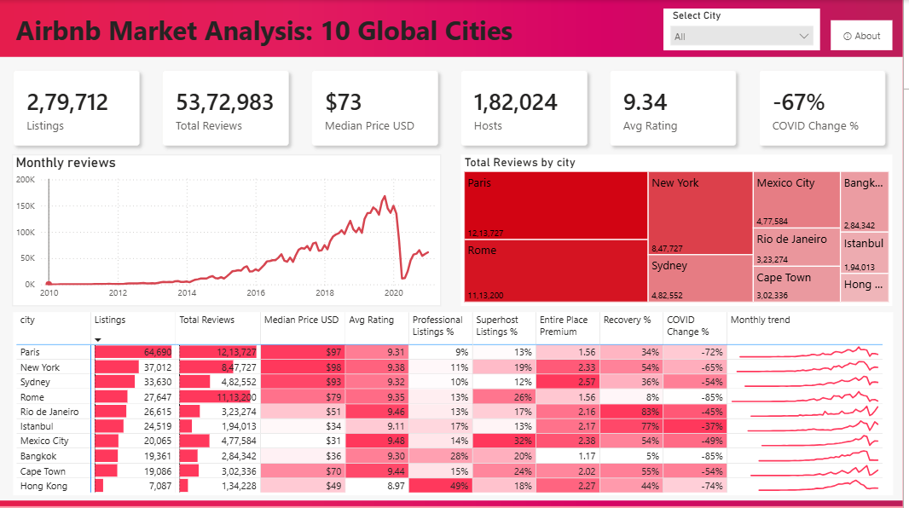
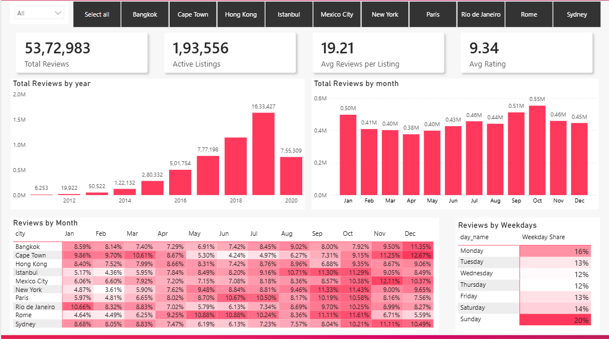
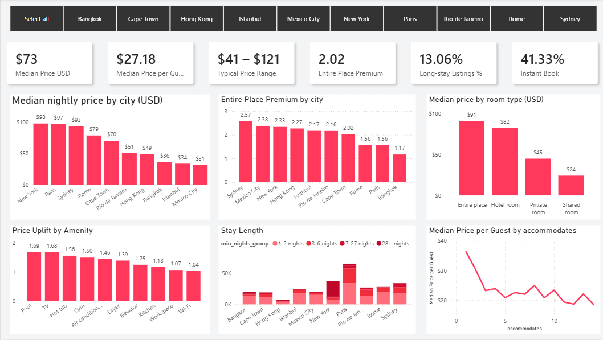
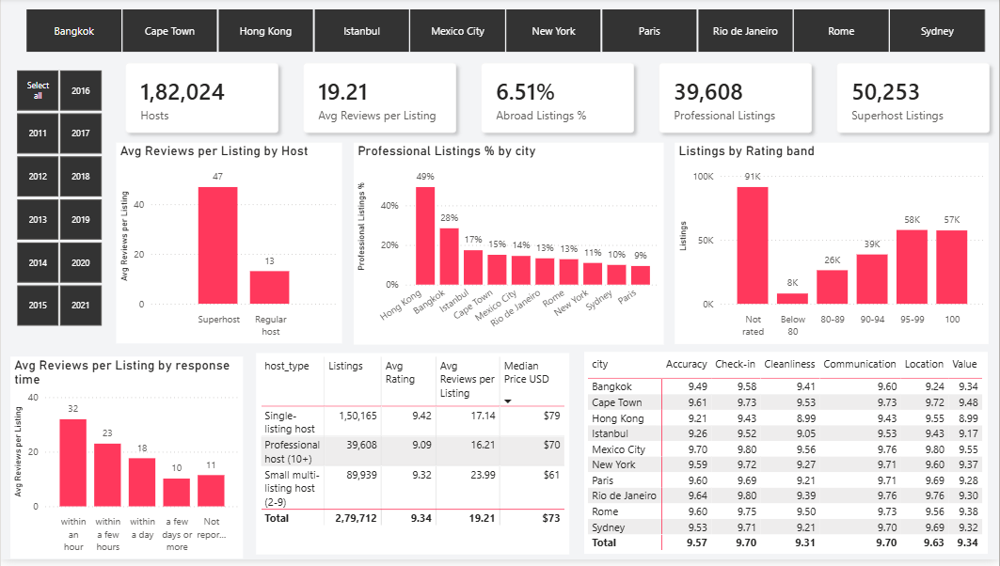
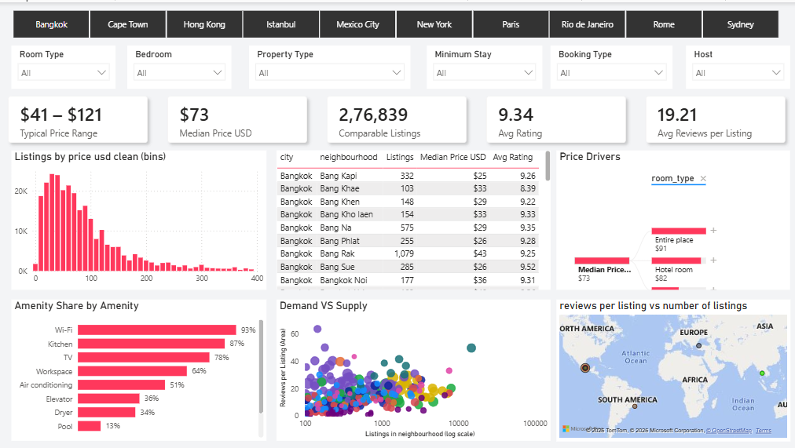

# Airbnb Market Analysis: 10 Cities, 5.4M Reviews (Python + Power BI)

An end-to-end analytics project. Raw Airbnb listing and review files for ten cities are cleaned in Python, modelled as a star schema, and explored in a five-page Power BI dashboard.

**Data:** Inside Airbnb data as packaged by the Maven Analytics Data Playground. 10 cities, 279,712 listings, 182,024 hosts, 5,372,983 reviews, Nov 2008 to Mar 2021.

## The problem
Raw rows do not show where demand is concentrated, how COVID changed it, or what drives price. Ten cities with different currencies, seasons and host mixes cannot be compared until the data is cleaned and put in one model.

## What I did
1. **Cleaned the data in Python (pandas, run in VS Code).** Removed 160 duplicate reviews, converted local prices to USD using ECB rates of 26 Feb 2021, flagged outlier prices instead of deleting them, capped placeholder values, repaired broken text, and built amenity and host features. The script is [`airbnb_cleaning.py`](airbnb_cleaning.py).
2. **Modelled a star schema in Power BI:** `fact_reviews` with `dim_listing`, `dim_host`, `dim_city`, `dim_date` and `neighbourhood_summary`. Measures are written in DAX.
3. **Built a five-page dashboard:** Overview, Demand, Pricing, Hosts and Quality, Explore.

## Key findings
Reviews are a proxy for stays, and every finding below is an association, not a cause.
- Three cities (Paris, Rome, New York) hold 59% of all reviews.
- Reviews grew 43% in 2019, then fell 54% in 2020.
- March to December 2020 vs 2019: reviews fell 67% overall (Bangkok and Rome about 85%, Istanbul 37%). By January 2021, Rio de Janeiro was at 83% of its January 2020 level and Bangkok at 5%.
- Demand peaks in October and is lowest in February. New York swings 3.17x between peak and trough.
- Entire places have a median price about 2x private rooms. Pool and TV listings go with prices about 1.7x higher.
- Professional hosts (10+ listings) run 49% of Hong Kong listings and 9% of Paris listings.
- Superhosts average 47 reviews per listing against 13 for other hosts, and rate 9.7 against 9.2.

## Dashboard
| Overview | Demand |
|---|---|
|  |  |

| Pricing | Hosts and Quality |
|---|---|
|  |  |

| Explore | About |
|---|---|
|  |  |

## Files
| File | What it is |
|---|---|
| `airbnb_cleaning.py` | Cleaning script: raw files in, six model tables out, plus a data dictionary and cleaning report |
| `Airbnb_Market_Analysis_deck.pptx` | Project presentation |
| `screenshots/` | Dashboard page images |

The Power BI report (`Air_bnb_dashboard.pbix`) and the full cleaned tables (`airbnb_clean.zip`) are too large for the repository. Download them from the [**Releases**](../../releases) page.

## How to reproduce
1. Download `Listings.csv` and `Reviews.csv` from the Maven Analytics Data Playground and put them in the same folder as the script.
2. `pip install pandas numpy`
3. `python airbnb_cleaning.py`. This writes the cleaned tables, a data dictionary and a cleaning report to an `airbnb_clean` folder.
4. Open the report from Releases in Power BI Desktop, or load the tables yourself and create the star-schema relationships.

## Limitations
- Reviews are a proxy for stays, not bookings.
- January 2021 is the last complete month, because each city was scraped on a different day.
- Prices are listed nightly prices converted at a single exchange rate date.
- Findings show associations, not causes. Hong Kong's decline started before COVID.

## Author
**Omprakash Balara**, Data Analyst · B.Tech, IIT Roorkee
[LinkedIn](https://www.linkedin.com/in/omprakash-balara-8699b2268) · [GitHub](https://github.com/OpOm17055) · omprakashbalara7@gmail.com
